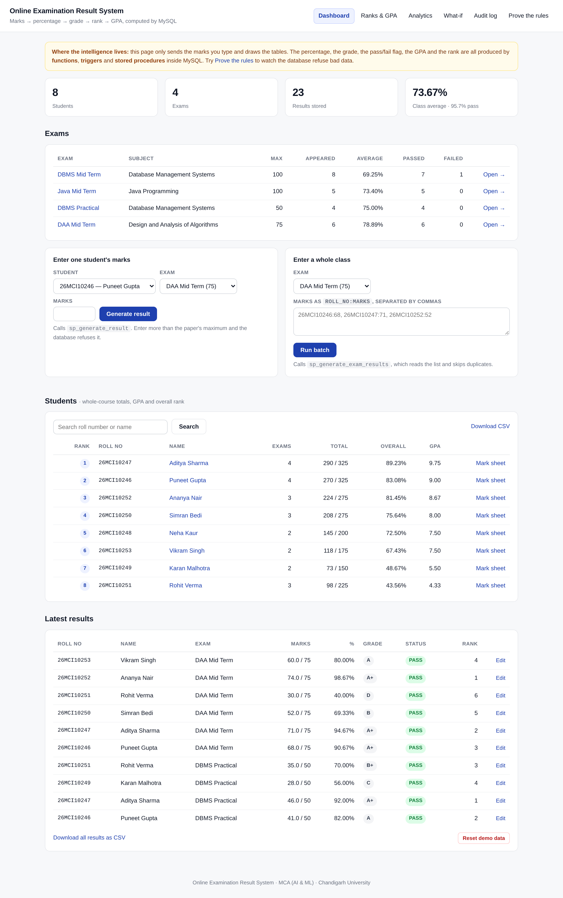

# Online Examination Result System

A small web application that stores exam marks, calculates percentages, assigns
grades, ranks students and computes a GPA — **with all of the logic inside MySQL**,
using stored procedures, functions and triggers.

MCA (AI & ML) mini project · Chandigarh University



---

## The idea in one paragraph

The website deliberately does very little. When a teacher types a mark, the page
does not calculate the percentage and it does not decide the grade. It calls a
stored procedure and displays whatever the database returns. If a mark is larger
than the maximum for that paper, the page does not stop it — the database refuses
to store the row and returns the reason, which the page then shows. The rules
live in one place, and every route to the data passes through them.

---

## See it work

| Page | What it demonstrates |
|---|---|
| **Dashboard** | Marks entry, class leaderboard with GPA and overall rank |
| **Merit list** | Rank produced by `RANK() OVER (ORDER BY percentage DESC)` |
| **Analytics** | Mean, median, standard deviation and pass rate, all computed in SQL |
| **What-if** | "What would 33 out of 75 get?" — answered by the functions, storing nothing |
| **Audit log** | Every insert, update and delete, written by triggers |
| **Prove the rules** | Six deliberate rule-breaks, each showing the database's real error |

The **Prove the rules** page runs real SQL statements against the live database,
bypassing every interface check, and prints what the database said:

```
Insert 150 marks into a 75-mark paper          REFUSED
  Result rejected: marks cannot exceed the maximum for this paper.

Insert a second result for the same student    REFUSED
  Duplicate entry '1-1' for key 'uq_result_once'

Insert a result for a student who does not exist  REFUSED
  Cannot add or update a child row: a foreign key constraint fails

Insert a negative mark                         REFUSED
Update a result to exceed the paper maximum    REFUSED
Insert a student with a duplicate roll number  REFUSED
```

That is the evidence for the viva: the rules hold even when the web interface is
bypassed entirely.

---

## What it does

| You do | The database does |
|---|---|
| Type a student's marks | Computes the percentage, assigns the grade, sets PASS/FAIL |
| Enter marks for a whole class | A cursor reads the list, inserts each row, skips duplicates |
| Open the merit list | `RANK() OVER (ORDER BY percentage DESC)` produces the ranks |
| Open the analytics page | Computes the average, median, standard deviation and pass rate |
| Open the mark sheet | Sums the marks and averages the grade points into a GPA |
| Enter marks above the paper maximum | **Refuses the row** and explains why |
| Enter the same student twice | **Refuses** — one result per student per exam |
| Correct a mark later | Recomputes percentage and grade, and writes an audit row |
| Delete a result | Removes it and records the deletion in the audit trail |

---

## Database objects

**Tables (4):** `students`, `exams`, `results`, `result_audit`

**Views (5):** `v_result_summary`, `v_exam_summary`, `v_grade_distribution`,
`v_student_totals`, `v_subject_summary`

**Functions (5):**

- `fn_calc_percentage(marks, max)` — percentage, rounded and clamped to 0–100
- `fn_get_grade(percentage)` — A+ / A / B+ / B / C / D / F
- `fn_get_rank(result_id)` — position inside the exam
- `fn_grade_points(grade)` — letter grade to grade points (A+ = 10 down to F = 0)
- `fn_class_topper(exam_id)` — roll number of the highest scorer

**Procedures (7):**

- `sp_generate_result` — one student's result, with OUT parameters for the id and message
- `sp_generate_exam_results` — a whole class from a `"roll:marks"` list, using a cursor
- `sp_merit_list` — ranked merit list for one exam
- `sp_student_report` — every exam one student has taken, with rank
- `sp_class_statistics` — mean, median, standard deviation, pass rate, topper
- `sp_update_marks` — correct a mark; the trigger redoes the arithmetic
- `sp_delete_result` — delete a result, leaving the deletion in the audit trail

**Triggers (5):**

- `trg_results_bi` — fills percentage, grade and pass/fail on insert; rejects marks over the maximum
- `trg_results_bu` — same recalculation on update
- `trg_results_ai` / `au` / `ad` — audit trail on insert, update and delete

**Grade scale:** ≥90 A+ · ≥80 A · ≥70 B+ · ≥60 B · ≥50 C · ≥40 D · else F · pass at ≥40 %
**Grade points:** A+ 10 · A 9 · B+ 8 · B 7 · C 6 · D 5 · F 0

---

## Running it

### Requirements

- MySQL 8 or MariaDB 10.5+
- Python 3.9+ with pip

### Steps

```bash
pip install -r requirements.txt
./run.sh
```

Then open <http://localhost:5000>.

`run.sh` builds the database, loads the demo data, creates the application's
MySQL user and starts the website.

If your MySQL root account has a password, run the two SQL files by hand:

```bash
mysql -u root -p < 01_schema.sql
mysql -u root -p < 02_seed_data.sql
python3 app.py
```

### Windows (XAMPP)

1. Start MySQL in the XAMPP control panel.
2. Open phpMyAdmin → Import → `01_schema.sql` → Go, then the same for `02_seed_data.sql`.
3. `pip install -r requirements.txt`
4. `python app.py`
5. Open <http://localhost:5000>

### Demo data

8 MCA students, 4 exams and 23 results. If you change things during a demo,
click **Reset demo data** at the bottom of the dashboard to put it all back.

### Console demonstration

`03_demo.sql` exercises the routines without the web page in the way:

```bash
mysql -u root --force < 03_demo.sql
```

The `--force` flag lets the script continue past the four statements that are
expected to fail. Every refusal is the database's own error message.

---

## Project report

The full report is in the `report` folder, in both formats:

- `report/Result_System_Project_Report.docx`
- `report/Result_System_Project_Report.pdf`

---

## Files

| File | Purpose |
|---|---|
| `01_schema.sql` | Database, tables, functions, triggers, procedures, views |
| `02_seed_data.sql` | 8 students, 4 exams, 23 results |
| `03_demo.sql` | Console demonstration of the main behaviours |
| `app.py` | Flask web front end — collects marks, displays results |
| `templates/` | Page templates |
| `figures/` | The data flow diagram (source and image) |
| `screenshots/` | Captured screens of the running system |
| `run.sh` | One-command setup and start |

---

## Design notes

**The website deliberately does very little.** It calls one procedure per action
and draws what comes back. If you deleted the website, the rules would still
hold; if you wrote your own client, the rules would still hold.

**Ranks are not stored.** They are calculated each time from the current marks,
so a rank can never go stale after someone's marks are corrected.

**The grade boundaries are in one place** — `fn_get_grade` — so changing
"60 = B" to "60 = B+" is a one-line edit that applies everywhere. The GPA
follows automatically, because `fn_grade_points` reads the grade.

**The audit trail is written by triggers, not by the application.** A change
made directly in the MySQL console is logged exactly the same as one made
through the website.
